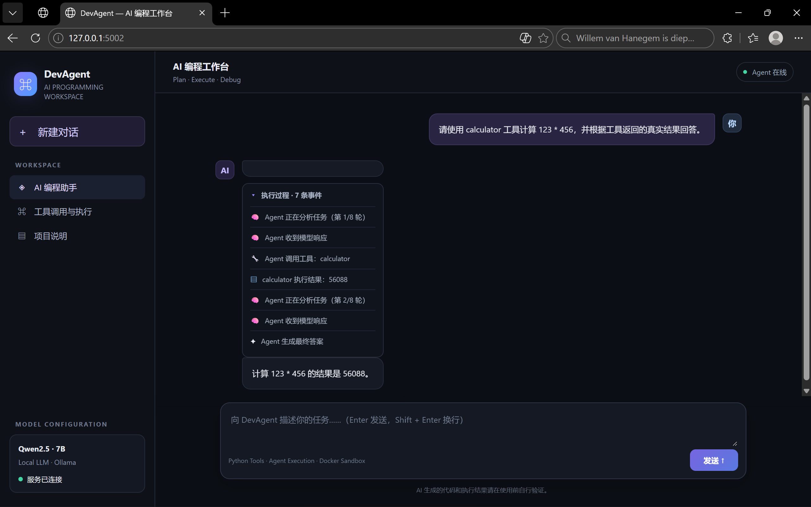

# AI Programming Agent

一个基于 **Ollama + Qwen** 构建的本地 AI Programming Agent。

## 项目演示



*AI Programming Agent 网页界面，展示用户任务、工具执行过程与最终回答。*


项目不是简单地调用大语言模型生成代码，而是让 Agent 能够围绕真实项目文件完成完整的编程任务闭环：

```text
理解任务
   ↓
分析项目
   ↓
读取真实代码
   ↓
发现问题
   ↓
修改真实文件
   ↓
执行代码
   ↓
分析执行结果
   ↓
继续 Debug
   ↓
验证成功
```

目前项目已经实现 **Tool Calling、项目文件操作、Docker Python Sandbox、真实项目 Debug、自动 Debug 循环以及 Web API** 等核心能力。

---

## 项目特点

- 基于 Ollama 运行本地 LLM
- 支持 Qwen 等本地模型
- 支持 LLM Tool Calling
- 支持读取真实项目文件
- 支持修改真实项目文件
- 支持 Python 代码执行
- 支持直接运行真实 Python 项目文件
- 使用 Docker 构建隔离的 Python Sandbox
- 限制沙箱 CPU、内存、进程数量和执行时间
- 禁用沙箱网络访问
- 支持最多 3 次自动 Debug 尝试
- Debug 时保持用户指定的目标文件路径
- 根据真实执行结果判断代码是否修复成功
- 支持 CLI 和 Web API 两种使用方式
- 使用 `.env` 管理 Ollama 地址和模型配置

---

# Agent 工作流程
